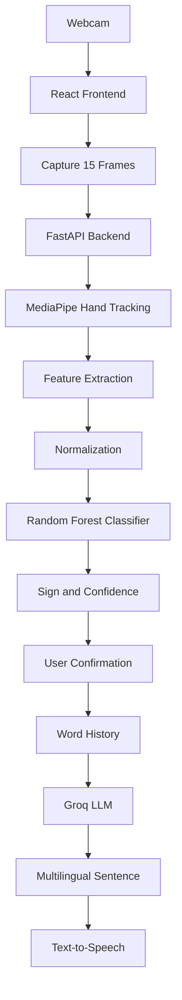

# SilentVoice

### Give every movement a voice.

SilentVoice is an AI-powered accessibility application that recognizes American Sign Language (ASL) gestures through a webcam, converts them into natural-language sentences, and reads them aloud.

Developed during a 12-hour hackathon, SilentVoice combines computer vision, machine learning and large language models to help bridge communication barriers.


---

## Features

- Live webcam capture.
- American Sign Language recognition.
- Real-time hand landmark detection using MediaPipe.
- Gesture classification using a trained Random Forest model.
- Prediction confidence meter.
- Unknown gesture rejection.
- Manual confirmation of recognized signs.
- Editable word history.
- AI-powered natural sentence generation.
- Multilingual translation.
- Text-to-speech.
- Responsive React interface.
- Mock and live prediction modes.

## Supported Signs

| Sign | Meaning |
|---|---|
| YES | Agreement or confirmation |
| NO | Disagreement or rejection |
| MORE | Request for more |
| STOP | Request to stop |
| FINISH | Completion of an action |
| UNKNOWN | Unrecognized gesture |

SilentVoice currently supports a limited vocabulary as a proof of concept.

## Supported Languages

| Language | Translation | Text-to-Speech |
|---|---|---|
| English | Supported | Supported |
| Hebrew | Supported | Requires a compatible browser voice |
| Russian | Supported | Supported |

## How It Works

1. The user performs an ASL gesture in front of a webcam.
2. The frontend captures 15 frames at approximately 100 ms intervals.
3. The frames are encoded as Base64 JPEG images.
4. The frontend sends the frames to the FastAPI backend.
5. MediaPipe extracts hand landmarks.
6. The landmarks are converted into a normalized feature sequence.
7. The trained Random Forest model predicts the corresponding sign.
8. The user confirms the prediction and adds it to the word history.
9. Groq's large language model transforms the recognized signs into a natural sentence.
10. The browser reads the generated sentence aloud.

## System Architecture



## Technology Stack

| Category | Technology |
|---|---|
| Frontend | React, Vite, JavaScript |
| Backend | Python, FastAPI, Uvicorn |
| Computer Vision | MediaPipe, OpenCV |
| Machine Learning | Scikit-learn, Random Forest |
| Numerical Computing | NumPy |
| Model Serialization | Joblib |
| Large Language Model | GPT-OSS 120B via Groq |
| Speech Synthesis | Web Speech API |
| Version Control | Git and GitHub |

## Machine Learning Model

The recognition model uses a Random Forest classifier trained on hand landmark sequences extracted from ASL video recordings.

### Model Parameters

| Parameter | Value |
|---|---|
| Classifier | Random Forest |
| Number of trees | 100 |
| Frames per prediction | 15 |
| Features per frame | 128 |
| Total features per prediction | 1,920 |
| Supported signs | 5 |
| Unknown gesture class | Yes |
| Confidence threshold | 0.35 |

### Feature Extraction

Each frame contains:

- 63 coordinates representing the left hand.
- 63 coordinates representing the right hand.
- 2 hand-presence indicators.

Each hand contains 21 landmarks with X, Y and Z coordinates.

The extracted landmarks are normalized to reduce sensitivity to hand position and scale while preserving movement information.

### Training Dataset

The training and development data were prepared using:

- WLASL — Word-Level American Sign Language dataset.
- ASL Citizen dataset.

The training pipeline includes:

- Video frame sampling.
- Hand landmark extraction.
- Feature normalization.
- Signer-aware training and development splitting.
- Temporal augmentation.
- Rotation augmentation.
- Gaussian noise augmentation.

Training and development recordings are separated by signer to reduce data leakage.

### Development Evaluation Results

| Metric | Result |
|---|---:|
| Original recordings | 230 |
| Signer groups | 57 |
| Original training samples | 178 |
| Augmented training samples, including originals | 1,068 |
| Development samples | 52 |
| Classification accuracy | 78.85% |
| Macro F1 score | 0.7490 |
| Median ML inference latency | 6.05 ms |
| 95th percentile ML inference latency | 7.67 ms |

### Per-Class Performance

| Sign | Precision | Recall | F1 Score |
|---|---:|---:|---:|
| YES | 67% | 67% | 67% |
| NO | 83% | 71% | 77% |
| MORE | 100% | 89% | 94% |
| STOP | 100% | 40% | 57% |
| FINISH | 80% | 67% | 73% |
| UNKNOWN | 72% | 95% | 82% |

These results were measured on recorded development data used during model tuning. They do not represent independent final test results or verified live recognition accuracy.

Inference latency measures the ML classification stage, excluding webcam capture, landmark extraction, network communication and LLM processing.

## Project Structure

```text
SilentVoice/
├── backend/
│   ├── main.py
│   ├── config.py
│   ├── schemas.py
│   ├── pipeline.py
│   ├── utils.py
│   ├── llm.py
│   └── llm_groq.py
├── vision/
│   ├── config.py
│   ├── hand_tracking.py
│   └── preprocessing.py
├── ml/
│   ├── config.py
│   ├── dataset.py
│   ├── features.py
│   ├── normalize.py
│   ├── augment.py
│   ├── prepare_dataset.py
│   ├── train.py
│   ├── predict.py
│   ├── evaluate.py
│   └── models/
├── frontend/
│   ├── src/
│   └── package.json
├── data/
├── .env.example
├── .gitignore
├── requirements.txt
└── README.md
```

## Installation

### Prerequisites

- Python 3.12
- Node.js and npm
- Git
- Webcam
- Groq API key
- Internet connection for AI sentence generation
- Required ASL and MediaPipe model files

### 1. Clone the Repository

```powershell
git clone https://github.com/ComplexTime/SilentVoice.git
cd SilentVoice
```

### 2. Create a Python Virtual Environment

```powershell
py -3.12 -m venv .venv
```

Activate the environment:

```powershell
.\.venv\Scripts\Activate.ps1
```

### 3. Install Python Dependencies

All Python dependencies are managed through the global requirements file.

```powershell
python -m pip install --upgrade pip
python -m pip install -r requirements.txt
python -m pip check
```

### 4. Configure Environment Variables

Create a local environment file if one does not already exist:

```powershell
Copy-Item .env.example .env
```

Open `.env` and configure the following variables:

```dotenv
GROQ_API_KEY=your_groq_api_key
GROQ_MODEL=openai/gpt-oss-120b
```

API keys can be obtained from:

https://console.groq.com/keys

Never commit the `.env` file or expose API keys in the frontend.

### 5. Verify Model Files

Verify that the trained ASL model is available:

```powershell
Test-Path ml/models/asl_model.joblib
```

Verify the MediaPipe model:

```powershell
python -c "from vision.config import HAND_LANDMARKER_MODEL; from pathlib import Path; print(Path(HAND_LANDMARKER_MODEL).exists())"
```

Both commands should return `True`.

If a model is missing, obtain an authorized copy or generate it locally using the corresponding training or setup process.

Training datasets and generated model files may not be included in the Git repository.

### 6. Install Frontend Dependencies

```powershell
cd frontend
npm install
cd ..
```

## Running the Application

SilentVoice requires two running terminals.

### Terminal 1 — Backend

From the repository root:

```powershell
.\.venv\Scripts\Activate.ps1
python -m uvicorn backend.main:app --reload --port 8000
```

Backend:

http://localhost:8000

Interactive API documentation:

http://localhost:8000/docs

### Terminal 2 — Frontend

From the repository root:

```powershell
cd frontend
npm run dev
```

Open the application:

http://localhost:5173

Both terminals must remain running while using SilentVoice.

## Configuration

### Backend Configuration

File: `backend/config.py`

```python
MOCK_MODE = False
```

### Frontend Configuration

File: `frontend/src/config.js`

```javascript
export const USE_MOCK = false;
export const MIN_CONFIDENCE = 0.35;
```

The API base URL must point to:

```text
http://localhost:8000
```

Mock mode can be enabled for interface demonstrations without live gesture recognition. For actual recognition, both mock modes must be disabled.

## API Reference

### GET /api/health

Checks whether the backend is running.

Example response:

```json
{
    "status": "healthy",
    "mock_mode": false,
    "sign_language": "ASL"
}
```

### POST /api/predict

Recognizes an ASL gesture from 15 Base64-encoded JPEG frames.

Request structure:

```json
{
    "frames": [
        "base64_jpeg_1",
        "...",
        "base64_jpeg_15"
    ]
}
```

The actual request must contain exactly 15 valid images without the Base64 data URL prefix.

Example response:

```json
{
    "sign": "MORE",
    "confidence": 0.72
}
```

Confidence values range from 0 to 1.

### POST /api/translate

Transforms recognized signs into a natural-language sentence.

Example request:

```json
{
    "signs": ["YES", "MORE"],
    "language": "en"
}
```

Example response:

```json
{
    "sentence": "Yes, I want more."
}
```

Supported language codes:

| Code | Language |
|---|---|
| en | English |
| he | Hebrew |
| ru | Russian |

Generated sentences may vary depending on the LLM response.

## Model Evaluation

To evaluate the trained model using the local development dataset:

```powershell
.\.venv\Scripts\Activate.ps1
python -m ml.evaluate
```

The evaluation requires the trained model and its corresponding processed dataset.

The evaluation reports classification accuracy, precision, recall, F1 scores and inference latency.

## Troubleshooting

| Problem | Possible Solution |
|---|---|
| Backend cannot start | Activate the virtual environment and install dependencies |
| Frontend cannot start | Run npm install inside frontend |
| Failed to fetch | Verify that the backend is running on port 8000 |
| CORS error | Verify that the backend permits the frontend origin |
| HTTP 422 | Verify the request format and frame count |
| HTTP 500 | Inspect the backend terminal traceback |
| Missing model | Verify the required model files |
| Camera unavailable | Check browser camera permissions |
| Translation fails | Verify the Groq API key and internet connection |
| All predictions rejected | Verify the confidence threshold and model configuration |
| Hebrew speech unavailable | Use a compatible browser with an available Hebrew voice |
| OpenCV import error | Ensure only one OpenCV distribution is installed |

## Known Limitations

- Currently recognizes five ASL signs rather than the complete ASL vocabulary.
- Recognition accuracy depends on lighting, camera positioning and gesture execution.
- Live recognition accuracy requires further evaluation.
- The confidence score is a classifier score, not a guaranteed probability of correctness.
- Signs are recorded individually rather than continuously translated.
- AI-generated sentences may require user review.
- Groq translation requires internet connectivity.
- Hebrew speech depends on browser voice availability and is deferred for the current demonstration.

## Future Improvements

- Expand the supported ASL vocabulary.
- Collect additional diverse training recordings.
- Improve gesture classification accuracy.
- Introduce continuous sign recognition.
- Improve temporal movement classification.
- Support additional sign languages.
- Add reliable multilingual speech synthesis.
- Introduce mobile-device support.
- Improve accessibility and user customization.
- Validate the application with experienced ASL users.

## Development Workflow

SilentVoice uses GitHub for collaborative development.

Feature branches:

```text
main
feature/backend
feature/vision
feature/ml
feature/frontend
```

Recommended workflow:

1. Create a feature branch.
2. Implement and test changes.
3. Commit only relevant files.
4. Push the feature branch.
5. Open a Pull Request.
6. Review and merge into main.

Never commit API keys, environment files, virtual environments, node_modules or restricted datasets.

## Team

SilentVoice was developed by a four-person hackathon team with responsibilities divided into:

| Role | Responsibility |
|---|---|
| Project Manager / Backend | Project architecture, FastAPI, LLM and integration |
| Computer Vision Developer | MediaPipe and hand landmark detection |
| Machine Learning Developer | Dataset preparation, training and classification |
| Frontend Developer | React interface, webcam capture and speech synthesis |

## Acknowledgments

- [MediaPipe](https://github.com/google-ai-edge/mediapipe)
- [OpenCV](https://opencv.org/)
- [Scikit-learn](https://scikit-learn.org/)
- [FastAPI](https://fastapi.tiangolo.com/)
- [React](https://react.dev/)
- [Groq](https://groq.com/)
- [WLASL](https://github.com/dxli94/WLASL)
- [ASL Citizen](https://www.microsoft.com/en-us/research/project/asl-citizen/)

Datasets and third-party models remain subject to their respective licenses and usage conditions.

---

**SilentVoice — Give every movement a voice.**

Movement. Intelligence. Communication.