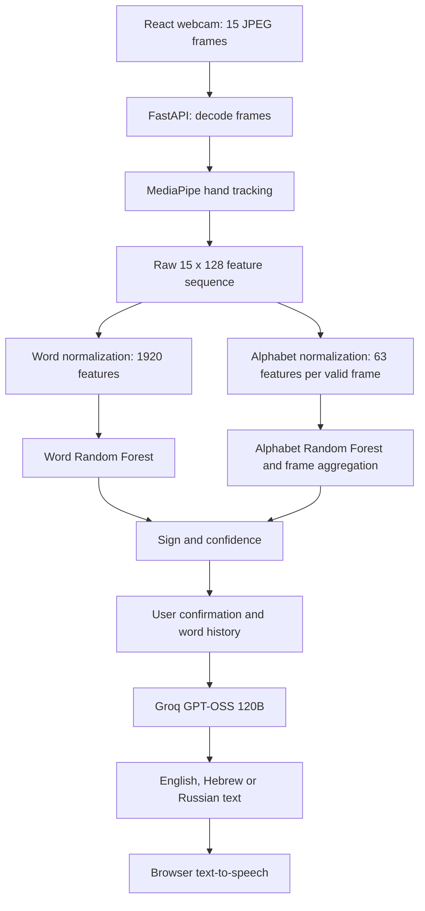

# SilentVoice

**Give every movement a voice.**

SilentVoice is an AI-powered accessibility prototype developed by a four-person team during a 12-hour hackathon. It recognizes isolated American Sign Language (ASL) signs and fingerspelled letters through a webcam, turns confirmed words into natural-language sentences using a large language model, and reads the results aloud.

     

## Features

| Feature | Support |
| --- | --- |
| Word recognition | YES, NO, MORE, STOP, FINISH |
| Alphabet recognition | 24 static ASL letters (A–Z excluding J and Z) |
| Gesture rejection | UNKNOWN when the model rejects a prediction |
| Fingerspelling | Letter confirmation, editable buffer, repeated letters, space and backspace |
| Sentence construction | Confirm signs or completed words before sending them to the LLM |
| Translation | English, Hebrew and Russian |
| Speech | English and Russian verified; Hebrew depends on browser voice availability |
| Learning guide | ASL alphabet reference in Alphabet mode |

J and Z require motion and are not supported by the current alphabet classifier. SilentVoice is a limited-vocabulary research prototype, not a complete ASL translator or a replacement for a qualified interpreter.

## Architecture



The frontend captures 15 frames at approximately 100 ms intervals, at 640 × 480 resolution. Only the preview is mirrored; the captured images are not. The raw feature vector contains 63 coordinates for each hand and two hand-presence flags. Word and alphabet models are independent and use different normalization pipelines.

## 1. Installation (Windows PowerShell)

### Prerequisites

- Python 3.12 (the team used Python 3.12.10)
- Node.js and npm compatible with the frontend's Vite version
- Git, webcam and a modern browser
- Internet access for downloads and Groq translation
- A Groq API key: <https://console.groq.com/keys>

All commands below start from the repository root unless otherwise stated.

### Clone the project

```powershell
git clone https://github.com/ComplexTime/SilentVoice.git
cd SilentVoice
```

If already cloned, save any local changes and run `git pull origin main` instead.

### Install Python dependencies

```powershell
py -3.12 -m venv .venv
.\.venv\Scripts\Activate.ps1
python -m pip install --upgrade pip
python -m pip install -r requirements.txt
python -m pip check
```

If the environment already exists, skip its creation. If activation is blocked by PowerShell policy, use `.\.venv\Scripts\python.exe` instead of `python` in the commands below, or use `Set-ExecutionPolicy -Scope Process Bypass` for the current trusted terminal session only.

The root `requirements.txt` is the single Python dependency list. Do not install both `opencv-python` and `opencv-contrib-python` into the same environment; the project uses the contrib distribution for `cv2`.

### Configure Groq

```powershell
if (-not (Test-Path .env)) { Copy-Item .env.example .env }
```

Open the root `.env` file and configure:

```dotenv
GROQ_API_KEY=your_groq_api_key
GROQ_MODEL=openai/gpt-oss-120b
```

Use your own API key. Never put it in the React frontend or commit `.env`.

### Install frontend dependencies

```powershell
cd frontend
npm install
cd ..
```

### Ensure the MediaPipe hand model is available

The Vision configuration determines the actual model path. Check it before downloading anything:

```powershell
python -c "from pathlib import Path; from vision.config import HAND_LANDMARKER_MODEL; p=Path(HAND_LANDMARKER_MODEL); print(p); print('Exists:',p.exists())"
```

If it is missing, download the official Hand Landmarker bundle directly into the configured location:

```powershell
python -c "from pathlib import Path; from urllib.request import urlretrieve; from vision.config import HAND_LANDMARKER_MODEL; p=Path(HAND_LANDMARKER_MODEL); p.parent.mkdir(parents=True,exist_ok=True); urlretrieve('https://storage.googleapis.com/mediapipe-models/hand_landmarker/hand_landmarker/float16/1/hand_landmarker.task',str(p)); print(p)"
```

### Check the trained recognition models

```powershell
Test-Path ml/models/asl_model.joblib
Test-Path ml/models/alphabet_model.joblib
```

If both commands return `True` and the files are from a trusted, compatible source, training is not necessary to run the application. Otherwise, follow the training sections below for the missing model. Model and dataset availability can differ between computers.

## 2. Train the word recognition model

This model recognizes the five supported word signs and UNKNOWN. Training downloads ASL video examples, extracts sequences of hand landmarks, normalizes them and fits a Random Forest classifier.

### 2.1 Download the video datasets

Review the [WLASL terms](https://github.com/dxli94/WLASL) and [ASL Citizen license](https://www.microsoft.com/en-us/research/project/asl-citizen/dataset-license/) before downloading or using the recordings. These are research datasets with restrictions; do not redistribute their contents or assume unrestricted rights to distribute derived artifacts.

Run the following modules in this order:

```powershell
python -m ml.download_wlasl
python -m ml.download_asl_citizen
```

The first script downloads a selected vocabulary from WLASL using its metadata and the Voxel51 Hugging Face dataset. The second adds selected ASL Citizen recordings to the existing manifest. Its official test partition is not downloaded by this script.

Do not rerun the WLASL downloader after appending ASL Citizen unless you intentionally want to rebuild the manifest. It writes a new manifest.

Expected data location:

```text
data/wlasl/
    manifest.csv
    citizen/
    ... downloaded video files ...
```

Availability of remote videos may change; sample counts are not guaranteed to match previous training runs.

### 2.2 Extract the word features

```powershell
python -m ml.prepare_dataset
```

This processes the video manifest, samples 15 frames per recording, extracts the raw features and saves:

```text
data/training.npz
```

The file contains `X` of shape `(N, 15, 128)`, labels `y`, and signer/session groups `groups`.

### 2.3 Train and evaluate

```powershell
python -m ml.train
python -m ml.evaluate
```

The model is saved to `ml/models/asl_model.joblib`. The evaluation produces classification metrics and `ml/models/confusion_matrix.png`.

The training pipeline separates signer groups, normalizes landmarks and augments only the training partition. The model configuration lives in `ml/config.py`; the word confidence threshold is 0.35. The configured vocabulary may contain an untrained label (`I_LOVE_YOU`); only advertise classes present in the actual model.

The following command is optional for inspecting the real dataset and checking its split:

```powershell
python -m ml.dataset --real
```

### Recorded development results (hackathon run)

| Metric | Result |
| --- | ---: |
| Original recordings | 230 |
| Signer groups | 57 |
| Training recordings | 178 |
| Training examples after augmentation | 1,068 |
| Development recordings | 52 |
| Accuracy | 78.85% |
| Macro F1 | 0.7490 |
| Median classifier inference latency | 6.05 ms |

These are historical development results, not guarantees for a fresh training run. The same development split was used during tuning. The inference latency excludes camera capture, hand tracking, networking and LLM processing.

## 3. Train the alphabet recognition model

The alphabet classifier recognizes 24 static letters using 63 normalized features per valid single-hand frame. It averages the predicted class probabilities across valid frames and rejects low-confidence predictions. The word model is not modified by this process.

### 3.1 Download the alphabet dataset

Use version 1 of the [American Sign Language Alphabet Dataset](https://data.mendeley.com/datasets/jdyksv2jhh/1) by Elisa Cabana Garceran del Vall (2025), licensed CC BY 4.0. See the attribution section below.

Download the ZIP from the dataset page and place it at `data/alphabet/dataset.zip`.

To create the folder and extract a downloaded ZIP:

```powershell
New-Item -ItemType Directory -Force data/alphabet
Expand-Archive -Path data/alphabet/dataset.zip -DestinationPath data/alphabet -Force
```

If the archive contains an extra parent folder, move its `Train` and `Test` folders into `data/alphabet/` so the final structure matches:

```text
data/alphabet/
    Train/
        A/ B/ C/ D/ E/ F/ G/ H/ I/ K/ L/ M/
        N/ O/ P/ Q/ R/ S/ T/ U/ V/ W/ X/ Y/
    Test/
        A/ B/ C/ D/ E/ F/ G/ H/ I/ K/ L/ M/
        N/ O/ P/ Q/ R/ S/ T/ U/ V/ W/ X/ Y/
```

Check the folders:

```powershell
tree data\alphabet /A
```

The `__MACOSX` metadata directory, if present, is not required. Keep the original Train and Test partitions separate.

### 3.2 Prepare alphabet features

First, run a small extraction test:

```powershell
python -m ml.alphabet_dataset --train-per-letter 5 --test-per-letter 2
```

If it succeeds, generate the full hackathon subset:

```powershell
python -m ml.alphabet_dataset --train-per-letter 150 --test-per-letter 40
```

The second command replaces the small extraction with the larger dataset at `data/alphabet_training.npz`. It processes raw images with MediaPipe, resizes with aspect-preserving padding and applies `vision/alphabet_features.py`. Detection failures can reduce the number of accepted examples.

Verify the output:

```powershell
Test-Path data/alphabet_training.npz
```

The historical run yielded 3,600 training images and 683 test images across all 24 classes, each represented by 63 features.

### 3.3 Set the alphabet confidence threshold

Open `ml/alphabet_config.py` and use:

```python
CONFIDENCE_THRESHOLD = 0.35
```

Then train:

```powershell
python -m ml.alphabet_train
```

This fits the separate Random Forest classifier, prints a classification report and saves `ml/models/alphabet_model.joblib`. The training module also reports evaluation metrics; a separate alphabet evaluation module is not required.

Verify the saved model:

```powershell
python -c "import joblib; a=joblib.load('ml/models/alphabet_model.joblib'); print('Threshold:',a['confidence_threshold']); print('Classes:',a['model'].classes_)"
```

Expected: threshold `0.35` and 24 classes (no J or Z). Only load Joblib artifacts that you created or received from a trusted source because they can execute code during deserialization.

If an existing alphabet model contains the old threshold of 0.50, you can update its trusted local artifact without retraining:

```powershell
python -c "import joblib; p='ml/models/alphabet_model.joblib'; a=joblib.load(p); a['confidence_threshold']=0.35; joblib.dump(a,p,compress=3); print(a['confidence_threshold'])"
```

Keep the Python configuration consistent with the artifact, and restart the backend after changing the file because the predictor caches the model.

### 3.4 Verify no-hand rejection

```powershell
python -c "import numpy as np; from ml.alphabet_predict import predict_letter; print(predict_letter(np.zeros((15,128),dtype=np.float32)))"
```

Expected:

```text
{'sign': 'UNKNOWN', 'confidence': 0.0}
```

### Recorded alphabet development results

| Confidence threshold | Correct / all images | Rejected | Correct / accepted images |
| ---: | ---: | ---: | ---: |
| 0.35 | 73.79% | 15.67% | 87.50% |
| 0.50 | 60.18% | 35.43% | 93.20% |

The selected threshold prioritizes recognition coverage while allowing manual confirmation. These are image-level development results from the dataset's original Test folder, which was used for threshold selection. Signer independence was not verified. Unsupported-gesture rejection and live video accuracy require separate evaluation; the reported accuracy is not a live webcam benchmark.

## 4. Run SilentVoice

### Configuration

In `backend/config.py`:

```python
MOCK_MODE = False
```

In `frontend/src/config.js`:

```javascript
export const USE_MOCK = false;
export const API_BASE_URL = "http://localhost:8000";
export const MIN_CONFIDENCE = 0.35;
export const ALPHABET_MIN_CONFIDENCE = 0;
```

The alphabet threshold of zero in the frontend is intentional: the backend makes the alphabet rejection decision. The frontend must not accept UNKNOWN. Mock mode is for interface development, not a live recognition demonstration.

### Terminal 1 — Backend

From the root directory:

```powershell
.\.venv\Scripts\Activate.ps1
python -m uvicorn backend.main:app --reload --port 8000
```

- Health check: <http://localhost:8000/api/health>
- Interactive API documentation: <http://localhost:8000/docs>

### Terminal 2 — Frontend

From the root directory, in a separate terminal:

```powershell
cd frontend
npm run dev
```

Open **<http://localhost:5173>** and allow camera access. Keep both terminals open.

### Using the application

1. Start the webcam.
2. Select Word mode or Alphabet mode.
3. Perform a supported sign or hold a letter pose and press Record Sign/Record Letter.
4. Review the result and confidence. Confirm the prediction or discard it and retry.
5. In Alphabet mode, confirm letters one by one and add the completed word to the sentence history. The learning guide displays the ASL hand positions.
6. Select English, Hebrew or Russian and press Translate.
7. Press Speak to read the generated sentence aloud, if a compatible browser voice is installed.

## 5. API reference

| Method | Endpoint | Purpose |
| --- | --- | --- |
| GET | `/` | Project information |
| GET | `/api/health` | Backend status and mock-mode configuration |
| POST | `/api/predict` | Word recognition |
| POST | `/api/predict/alphabet` | Alphabet recognition |
| POST | `/api/translate` | Generate a natural-language sentence |

Both prediction endpoints accept the same request object:

```json
{"frames": ["base64_jpeg_1", "...", "base64_jpeg_15"]}
```

The array must contain exactly 15 actual Base64 JPEG strings, with no data URL prefix. The ellipsis above is illustrative and is not a valid frame.

Example word response:

```json
{"sign": "MORE", "confidence": 0.72}
```

Example alphabet response:

```json
{"sign": "A", "confidence": 0.91}
```

Example rejection:

```json
{"sign": "UNKNOWN", "confidence": 0.0}
```

The translation endpoint accepts between 1 and 50 words or confirmed signs:

```json
{"signs": ["YES", "MORE"], "language": "en"}
```

Example response (actual output varies):

```json
{"sentence": "Yes, I want more."}
```

Language codes are `en`, `he` and `ru`. Review generated sentences for accuracy; the LLM is not guaranteed to preserve every nuance.

## 6. Tests and troubleshooting

### Backend smoke tests

With the backend running:

```powershell
Invoke-RestMethod -Uri 'http://localhost:8000/api/health'
Invoke-RestMethod -Uri 'http://localhost:8000/api/translate' -Method Post -ContentType 'application/json' -Body (@{signs=@('HELLO','DANIEL');language='en'} | ConvertTo-Json)
```

### Vision tests

With the virtual environment active:

```powershell
python -m pip install pytest
python -m pytest tests/test_alphabet_features.py -q
```

For a real webcam capture check, stop the application camera first, keep the backend running, then execute:

```powershell
python -m vision.alphabet_e2e_check
```

Check the raw `(15, 128)` feature shape, valid `(N, 63)` alphabet samples, and the API response. A local preprocessing PASS does not establish classifier accuracy.

| Problem | What to check |
| --- | --- |
| Python import error | Activate `.venv`; install the root requirements file; use Python 3.12. |
| Missing model / HTTP 503 | Check the required model paths and complete model training if necessary. |
| HTTP 422 | Confirm the frame count is exactly 15 and the request fields match the API. |
| HTTP 500 | Read the Uvicorn traceback. Check model, image decoding and Vision integration. |
| Failed to fetch / CORS | Confirm ports 8000 and 5173 and the frontend origin allowed in `backend/config.py`. |
| Camera capture fails | Release the camera in other applications; verify desktop and browser camera permissions. On Windows, OpenCV DirectShow can be an alternative to MSMF. |
| Most letters are UNKNOWN | Verify the saved alphabet threshold, hand visibility, lighting and pose; restart backend after artifact changes. |
| Translation fails | Check the Groq key, network access and provider limits. Never print or share the key. |
| Hebrew voice unavailable | Try Edge with a compatible installed voice, or use Hebrew text with English/Russian speech as fallback. |
| OpenCV conflict | Keep only the OpenCV distribution required by the root requirements file. |

## 7. Project layout

Core files and generated artifacts (not an exhaustive listing):

```text
SilentVoice/
  backend/
    main.py
    config.py
    schemas.py
    utils.py
    pipeline.py
    alphabet_pipeline.py
    llm.py
    llm_groq.py
  vision/
    config.py
    hand_tracking.py
    alphabet_features.py
    alphabet_check.py
    alphabet_e2e_check.py
  ml/
    config.py
    download_wlasl.py
    download_asl_citizen.py
    prepare_dataset.py
    features.py
    normalize.py
    augment.py
    train.py
    predict.py
    evaluate.py
    alphabet_config.py
    alphabet_dataset.py
    alphabet_train.py
    alphabet_predict.py
    models/
      asl_model.joblib
      alphabet_model.joblib
  frontend/
    public/asl-alphabet.svg
    src/
      App.jsx
      App.css
      api.js
      config.js
      captureFrames.js
      components/
    package.json
  tests/test_alphabet_features.py
  data/
  .env.example
  .gitignore
  requirements.txt
  README.md
```

## 8. Development and demonstration

The team divided work across backend/integration, computer vision, machine learning and frontend. Keep the two recognition models independent, maintain the shared API contract and update the corresponding documentation when changing it.

Before presenting:

- [ ] Start the backend and frontend on the presenting laptop; verify both model files and the MediaPipe bundle.
- [ ] Verify that mock mode is disabled and camera permissions are granted.
- [ ] Test multiple supported word signs and static letters using live recordings.
- [ ] Confirm repeated letters, backspace, word construction, clearing and UNKNOWN rejection.
- [ ] Generate a sentence using multiple confirmed words and test all three text languages.
- [ ] Verify English or Russian speech and keep a working fallback language selected.
- [ ] Verify internet access for Groq; prepare a backup demonstration recording.

Use targeted Git staging and coordinate changes with teammates. Never force-push, commit secrets, virtual environments, `node_modules`, raw restricted datasets or unauthorized model artifacts.

## 9. Data sources and attribution

- **WLASL:** [Original repository](https://github.com/dxli94/WLASL) and [Voxel51 dataset mirror](https://huggingface.co/datasets/Voxel51/WLASL). Review the original dataset terms and underlying video rights.
- **ASL Citizen:** [Microsoft Research project](https://www.microsoft.com/en-us/research/project/asl-citizen/) and [dataset license](https://www.microsoft.com/en-us/research/project/asl-citizen/dataset-license/). The dataset is subject to non-commercial research-use restrictions.
- **Alphabet dataset:** Cabana Garceran del Vall, Elisa (2025), *American Sign Language Alphabet Dataset*, Mendeley Data, V1. <https://doi.org/10.17632/jdyksv2jhh.1>. Licensed [CC BY 4.0](https://creativecommons.org/licenses/by/4.0/). SilentVoice samples the images, resizes/pads them and extracts normalized hand landmarks to train a separate classifier.
- **Associated alphabet research paper:** Cabana, E. (2025). *Advancing Accessible AI: A Comprehensive Dataset and Neural Models for Real-Time American Sign Language Alphabet Classification*. In Intelligent Systems and Applications, IntelliSys 2025, Lecture Notes in Networks and Systems, vol. 1567, Springer, Cham. <https://doi.org/10.1007/978-3-032-00071-2_15>.
- **ASL reference chart:** Darren Stone (Ds13), vectorized by Marnanel, derived from David Rakowski's Gallaudet-TT font. [Wikimedia Commons source](https://commons.wikimedia.org/wiki/File:Asl_alphabet_gallaudet.svg), marked public domain by the author.
- **Hand tracking:** [Google MediaPipe Hand Landmarker](https://developers.google.com/edge/mediapipe/solutions/vision/hand_landmarker).

Third-party datasets, assets and models retain their respective terms. Do not assume that the project's source-code terms grant rights to redistribute restricted datasets or derived artifacts. The local training instructions are provided for eligible authorized use.

## 10. Limitations and future work

- Limited ASL word vocabulary and 24 static letters; motion-based J and Z are future work.
- Recognition quality depends on the signer, gesture execution, lighting, camera position and training coverage.
- Classifier confidence is not a calibrated guarantee of correctness. Alphabet rejection has not been independently validated against arbitrary non-letter gestures.
- Signs are captured individually, not continuously; ASL grammar and non-manual signals are not fully modeled.
- Translation requires internet access and may introduce wording not intended by the signer.
- Speech depends on the browser's available voices. Hebrew speech is deferred.
- Future work includes signer-independent validation, expanded vocabulary, dynamic-letter recognition, improved rejection and evaluation with experienced ASL users.

---

**SilentVoice — Give every movement a voice.**
